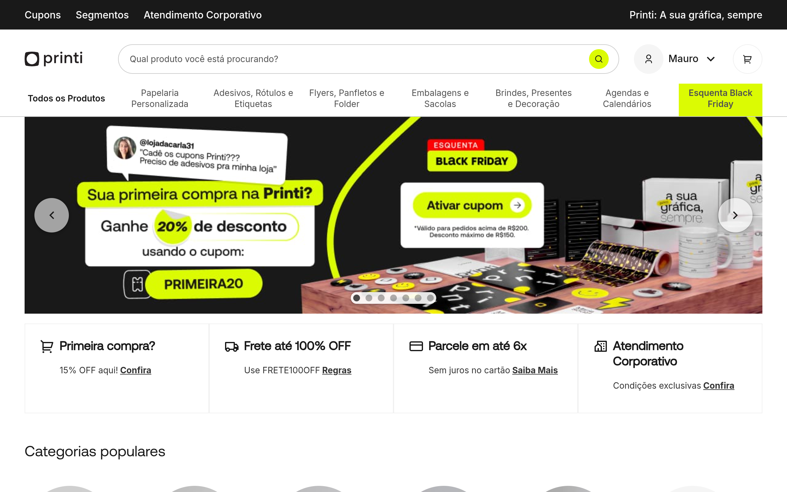

# printi Design System

You are building UI for **printi**. Light-themed, warm palette, sans-serif typography (__Aeonik_Fallback_13d87c), compact density on a 4px grid.

## Visual Reference

**IMPORTANT**: Study ALL screenshots below before writing any UI. Match colors, typography, spacing, layout, and motion exactly as shown.

### Homepage



> Read `references/DESIGN.md` for full token details.

## Design Philosophy

- **Layered depth** — use shadow tokens to create a sense of physical layering. Each elevation level has a specific shadow.
- **Gradient accents** — gradients are used thoughtfully for emphasis, not decoration.
- **Type pairing** — __Aeonik_Fallback_13d87c for body/UI text, __Aeonik_13d87c for headings/display. Never introduce a third typeface.
- **compact density** — 4px base grid. Every dimension is a multiple of 4.
- **warm palette** — the color temperature runs warm, matching the sans-serif typography.
- **Restrained accent** — `#b5ff95` is the only pop of color. Used exclusively for CTAs, links, focus rings, and active states.
- **Subtle motion** — transitions smooth state changes. Keep durations under 300ms, use ease-out curves.

## Color System

### Core Palette

| Role | Token | Hex | Use |
|------|-------|-----|-----|
| Background | `--background` | `#ffffff` | Page/app background |
| Surface | `--surface` | `#f5f5f5` | Cards, panels, modals |
| Text Primary | `--text-primary` | `#000000` | Headings, body text |
| Text Muted | `--text-muted` | `#525252` | Captions, placeholders |
| Accent | `--accent` | `#b5ff95` | CTAs, links, focus rings |
| Border | `--border` | `#232323` | Dividers, card borders |

### Status Colors

| Status | Hex | Use |
|--------|-----|-----|
| Success | `#efffe8` | Confirmations, positive trends |
| Warning | `#fff3d3` | Caution states, pending items |

### Extended Palette

- **color-grey-900:** `#191919` — Deep background layer or shadow color
- **color-neon-green-400:** `#dbfb03`
- **color-blue-600:** `#009bff`
- **color-blue-700:** `#0875c5`
- **color-grey-400:** `#8f8f8f`
- **color-grey-200:** `#e0e0e0`
- **color-grey-300:** `#cccccc`
- **color-grey-600:** `#3d3d3d`

### CSS Variable Tokens

```css
--elements-border-color: var(--color-grey-100);
--action-bg-primary-color: var(--color-grey-900);
--action-bg-secondary-color: var(--color-neon-green-400);
--action-border-primary-color: var(--color-grey-900);
--action-border-secondary-color: var(--color-neon-green-400);
--action-border-cta-color: var(--color-neon-green-400);
--action-label-primary-color: var(--color-grey-900);
--action-label-secondary-color: var(--color-neon-green-800);
--action-icon-primary-color: var(--color-grey-900);
--action-icon-secondary-color: var(--color-neon-green-800);
--on-action-label-primary-color: var(--color-grey-0);
--on-action-label-secondary-color: var(--color-neon-green-800);
--on-action-icon-primary-color: var(--color-grey-0);
--on-action-icon-secondary-color: var(--color-neon-green-800);
--inverse-border-color: var(--color-grey-0);
--active-border-color: var(--color-grey-900);
--unselected-border-color: var(--color-grey-200);
--selected-border-color: var(--color-grey-900);
--disabled-border-color: var(--color-grey-200);
--negative-border-color: var(--color-red-600);
```

## Typography

### Font Stack

- **__Aeonik_Fallback_13d87c** — Heading 1, Heading 2, Heading 3
- **__Aeonik_13d87c** — Body, Caption

### Font Sources

```css
@font-face {
  font-family: "__Aeonik_13d87c";
  src: url("fonts/__Aeonik_13d87c-Regular.woff2") format("woff2");
  font-weight: 400;
}
@font-face {
  font-family: "__Inter_d8ebd1";
  src: url("fonts/__Inter_d8ebd1-100.woff2") format("woff2");
  font-weight: 100;
}
```

### Type Scale

| Role | Family | Size | Weight |
|------|--------|------|--------|
| Heading 1 | __Aeonik_Fallback_13d87c | 32px | 700 |
| Heading 2 | __Aeonik_Fallback_13d87c | var(--font-size-md,24px) | 700 |
| Heading 3 | __Aeonik_Fallback_13d87c | 1.5rem | 700 |
| Body | __Aeonik_13d87c | var(--font-size-2xs,14px) | 400 |
| Caption | __Aeonik_13d87c | var(--font-size-xs,16px) | 400 |

### Typography Rules

- Body/UI: **__Aeonik_Fallback_13d87c**, Headings: **__Aeonik_13d87c** — these are the only display fonts
- Max 3-4 font sizes per screen
- Headings: weight 600-700, body: weight 400
- Use color and opacity for text hierarchy, not additional font sizes
- Line height: 1.5 for body, 1.2 for headings

## Spacing & Layout

### Base Grid: 4px

Every dimension (margin, padding, gap, width, height) must be a multiple of **4px**.

### Spacing Scale

`2, 4, 6, 8, 10, 12, 16, 20, 24, 40, 48, 80` px

### Spacing as Meaning

| Spacing | Use |
|---------|-----|
| 4-8px | Tight: related items (icon + label, avatar + name) |
| 12-16px | Medium: between groups within a section |
| 24-32px | Wide: between distinct sections |
| 48px+ | Vast: major page section breaks |

### Border Radius

Scale: `4px, 16px, 416.667px, 500px, inherit`
Default: `416.667px`

### Container

Max-width: `63.875em`, centered with auto margins.

### Breakpoints

| Name | Value |
|------|-------|
| xs | 25em |
| md | 48em |
| lg | 63.875em |
| lg | 63.9375em |
| xs | 320px |
| xs | 321px |
| xs | 345px |
| xs | 360px |
| xs | 438px |
| xs | 458px |
| sm | 600px |
| sm | 614px |
| md | 735px |
| md | 736px |
| md | 767px |
| md | 768px |
| lg | 769px |
| lg | 991px |
| lg | 992px |
| lg | 1021px |
| lg | 1023px |
| lg | 1024px |
| xl | 1025px |
| xl | 1044px |
| xl | 1138px |
| 2xl | 1400px |
| 2xl | 1439px |
| 2xl | 1440px |
| 2xl | 1480px |

Mobile-first: design for small screens, layer on responsive overrides.

## Component Patterns

### Card

```css
.card {
  background: #f5f5f5;
  border: 1px solid #232323;
  border-radius: 416.667px;
  padding: 16px;
  box-shadow: 0 2px 8px rgba(0,0,0,0.25),0 0 0 1px rgba(0,0,0,0.08);
}
```

```html
<div class="card">
  <h3>Card Title</h3>
  <p>Card content goes here.</p>
</div>
```

### Button

```css
/* Primary */
.btn-primary {
  background: #b5ff95;
  color: #000000;
  border-radius: 416.667px;
  padding: 8px 16px;
  font-weight: 500;
  transition: opacity 150ms ease;
}
.btn-primary:hover { opacity: 0.9; }

/* Ghost */
.btn-ghost {
  background: transparent;
  border: 1px solid #232323;
  color: #000000;
  border-radius: 416.667px;
  padding: 8px 16px;
}
```

```html
<button class="btn-primary">Get Started</button>
<button class="btn-ghost">Learn More</button>
```

### Input

```css
.input {
  background: #ffffff;
  border: 1px solid #232323;
  border-radius: 416.667px;
  padding: 8px 12px;
  color: #000000;
  font-size: 14px;
}
.input:focus { border-color: #b5ff95; outline: none; }
```

```html
<input class="input" type="text" placeholder="Search..." />
```

### Badge / Chip

```css
.badge {
  display: inline-flex;
  align-items: center;
  padding: 4px 8px;
  border-radius: 9999px;
  font-size: 12px;
  font-weight: 500;
  background: #f5f5f5;
  color: #525252;
}
```

```html
<span class="badge">New</span>
<span class="badge">Beta</span>
```

### Modal / Dialog

```css
.modal-backdrop { background: rgba(0, 0, 0, 0.6); }
.modal {
  background: #f5f5f5;
  border: 1px solid #232323;
  border-radius: inherit;
  padding: 24px;
  max-width: 480px;
  width: 90vw;
  box-shadow: 0 0 0 0 rgba(59,130,246,0);
}
```

```html
<div class="modal-backdrop">
  <div class="modal">
    <h2>Dialog Title</h2>
    <p>Dialog content.</p>
    <button class="btn-primary">Confirm</button>
    <button class="btn-ghost">Cancel</button>
  </div>
</div>
```

### Table

```css
.table { width: 100%; border-collapse: collapse; }
.table th {
  text-align: left;
  padding: 8px 12px;
  font-weight: 500;
  font-size: 12px;
  color: #525252;
  text-transform: uppercase;
  letter-spacing: 0.05em;
  border-bottom: 1px solid #232323;
}
.table td {
  padding: 12px;
  border-bottom: 1px solid #232323;
}
```

```html
<table class="table">
  <thead><tr><th>Name</th><th>Status</th><th>Date</th></tr></thead>
  <tbody>
    <tr><td>Item One</td><td>Active</td><td>Jan 1</td></tr>
    <tr><td>Item Two</td><td>Pending</td><td>Jan 2</td></tr>
  </tbody>
</table>
```

### Navigation

```css
.nav {
  display: flex;
  align-items: center;
  gap: 8px;
  padding: 12px 16px;
  border-bottom: 1px solid #232323;
}
.nav-link {
  color: #525252;
  padding: 8px 12px;
  border-radius: 416.667px;
  transition: color 150ms;
}
.nav-link:hover { color: #000000; }
.nav-link.active { color: #b5ff95; }
```

```html
<nav class="nav">
  <a href="/" class="nav-link active">Home</a>
  <a href="/about" class="nav-link">About</a>
  <a href="/pricing" class="nav-link">Pricing</a>
  <button class="btn-primary" style="margin-left: auto">Get Started</button>
</nav>
```

### Extracted Components

These components were found in the codebase:

**Button** (`html`)

**Input** (`html`)

## Page Structure

The following page sections were detected:

- **Navigation** — Top navigation bar (190 items)
- **Hero** — Hero/banner section with headline and CTAs
- **Footer** — Page footer with links and info (1 items)
- **Faq** — FAQ/accordion section
- **Cards** — Grid of 18 card elements (18 items)

When building pages, follow this section order and structure.

## Animation & Motion

This project uses **subtle motion**. Transitions smooth state changes without calling attention.

### CSS Animations

- `cmYSia`
- `bVpqQb`
- `lagRDW`
- `clickBlink`

### Motion Tokens

- **Duration scale:** `0ms`, `7s`, `200ms`, `250ms`, `300ms`, `400ms`, `500ms`, `800ms`, `1000ms`
- **Easing functions:** `ease-in-out`, `ease`, `cubic-bezier(0,0,1,1)`, `linear`
- **Animated properties:** `opacity`

### Motion Guidelines

- **Duration:** Use values from the duration scale above. Short (0ms) for micro-interactions, long (1000ms) for page transitions
- **Easing:** Use `ease-in-out` as the default easing curve
- **Direction:** Elements enter from bottom/right, exit to top/left
- **Reduced motion:** Always respect `prefers-reduced-motion` — disable animations when set

## Depth & Elevation

### Shadow Tokens

- Subtle: `0px 1px 2px rgba(16,24,40,0.05)`
- Raised (cards, buttons): `0 2px 8px rgba(0,0,0,0.25),0 0 0 1px rgba(0,0,0,0.08)`
- Raised (cards, buttons): `var(--shadow-level-3)`
- Raised (cards, buttons): `var(--shadow-md)`
- Raised (cards, buttons): `0 0 0 var(--border-width-md) var(--selected-border-color)`
- Raised (cards, buttons): `0 0 0 0 rgba(204,204,204,0.6)`

### Z-Index Scale

`0, 1, 2, 1000, 1001, 1002, 2000, 3000, 9998, 9999`

Use these exact values — never invent z-index values.

## Anti-Patterns (Never Do)

- **No blur effects** — no backdrop-blur, no filter: blur()
- **No zebra striping** — tables and lists use borders for separation
- **No invented colors** — every hex value must come from the palette above
- **No arbitrary spacing** — every dimension is a multiple of 4px
- **No extra fonts** — only __Aeonik_Fallback_13d87c and __Aeonik_13d87c are allowed
- **No arbitrary border-radius** — use the scale: 4px, 16px, 416.667px, 500px
- **No opacity for disabled states** — use muted colors instead

## Workflow

1. **Read** `references/DESIGN.md` before writing any UI code
2. **Pick colors** from the Color System section — never invent new ones
3. **Set typography** — __Aeonik_Fallback_13d87c, __Aeonik_13d87c only, using the type scale
4. **Build layout** on the 4px grid — check every margin, padding, gap
5. **Match components** to patterns above before creating new ones
6. **Apply elevation** — use shadow tokens
7. **Validate** — every value traces back to a design token. No magic numbers.

## Brand Spec

- **Favicon:** `/favicon.ico`
- **Site URL:** `https://www.printi.com.br`
- **Brand color:** `#b5ff95`
- **Brand typeface:** __Aeonik_Fallback_13d87c

## Quick Reference

```
Background:     #ffffff
Surface:        #f5f5f5
Text:           #000000 / #525252
Accent:         #b5ff95
Border:         #232323
Font:           __Aeonik_Fallback_13d87c
Spacing:        4px grid
Radius:         416.667px
Components:     9 detected
```

## When to Trigger

Activate this skill when:
- Creating new components, pages, or visual elements for printi
- Writing CSS, Tailwind classes, styled-components, or inline styles
- Building page layouts, templates, or responsive designs
- Reviewing UI code for design consistency
- The user mentions "printi" design, style, UI, or theme
- Generating mockups, wireframes, or visual prototypes

---

# Full Reference Files

> Every output file is embedded below. Claude has full design system context from /skills alone.

## Design System Tokens (DESIGN.md)

# printi DESIGN.md

> Auto-generated design system — reverse-engineered via static analysis by skillui.
> Frameworks: None detected
> Colors: 20 · Fonts: 2 · Components: 9
> Icon library: not detected · State: not detected
> Primary theme: light · Dark mode toggle: no · Motion: subtle

## Visual Reference

**Match this design exactly** — study colors, fonts, spacing, and component shapes before writing any UI code.


---

## 1. Visual Theme & Atmosphere

This is a **light-themed** interface with a warm, approachable feel. The light background emphasizes content clarity. Typography pairs **__Aeonik_13d87c** for display/headings with **__Aeonik_Fallback_13d87c** for body text, creating clear visual hierarchy through type contrast. Spacing follows a **4px base grid** (compact density), with scale: 2, 4, 6, 8, 10, 12, 16, 20px. The accent color **#b5ff95** anchors interactive elements (buttons, links, focus rings). Motion is subtle — smooth transitions (150-300ms) ease state changes without drawing attention.

---

## 2. Color Palette & Roles

| Token | Hex | Role | Use |
|---|---|---|---|
| theme-color | `#ffffff` | background | Page background, darkest surface |
| color-grey-50 | `#f5f5f5` | surface | Card and panel backgrounds |
| text-primary | `#000000` | text-primary | Headings and body text |
| color-grey-500 | `#525252` | text-muted | Captions, placeholders, secondary info |
| color-grey-800 | `#232323` | border | Dividers, card borders, outlines |
| color-green-100 | `#b5ff95` | accent | CTAs, links, focus rings, active states |
| color-green-0 | `#efffe8` | success | Success states, positive indicators |
| color-orange-50 | `#fff3d3` | warning | Warning states, caution indicators |
| color-blue-600 | `#009bff` | info | Informational highlights |
| color-grey-900 | `#191919` | unknown | Palette color |
| color-neon-green-400 | `#dbfb03` | unknown | Palette color |
| color-blue-700 | `#0875c5` | unknown | Palette color |
| color-grey-400 | `#8f8f8f` | unknown | Palette color |
| color-grey-200 | `#e0e0e0` | unknown | Palette color |
| color-grey-300 | `#cccccc` | unknown | Palette color |
| color-grey-600 | `#3d3d3d` | unknown | Palette color |
| color-grey-700 | `#333333` | unknown | Palette color |
| color-green-50 | `#d8ffc7` | unknown | Palette color |
| color-green-200 | `#86ff52` | unknown | Palette color |
| color-green-300 | `#4ced07` | unknown | Palette color |

### CSS Variable Tokens

```css
--elements-border-color: var(--color-grey-100);
--action-bg-primary-color: var(--color-grey-900);
--action-bg-secondary-color: var(--color-neon-green-400);
--action-border-primary-color: var(--color-grey-900);
--action-border-secondary-color: var(--color-neon-green-400);
--action-border-cta-color: var(--color-neon-green-400);
--action-label-primary-color: var(--color-grey-900);
--action-label-secondary-color: var(--color-neon-green-800);
--action-icon-primary-color: var(--color-grey-900);
--action-icon-secondary-color: var(--color-neon-green-800);
--on-action-label-primary-color: var(--color-grey-0);
--on-action-label-secondary-color: var(--color-neon-green-800);
--on-action-icon-primary-color: var(--color-grey-0);
--on-action-icon-secondary-color: var(--color-neon-green-800);
--inverse-border-color: var(--color-grey-0);
--active-border-color: var(--color-grey-900);
--unselected-border-color: var(--color-grey-200);
--selected-border-color: var(--color-grey-900);
--disabled-border-color: var(--color-grey-200);
--negative-border-color: var(--color-red-600);
```


---

## 3. Typography Rules

**Font Stack:**
- **__Aeonik_Fallback_13d87c** — Heading 1, Heading 2, Heading 3
- **__Aeonik_13d87c** — Body, Caption

**Font Sources:**

```css
@font-face {
  font-family: "__Aeonik_13d87c";
  src: url("fonts/__Aeonik_13d87c-Regular.woff2") format("woff2");
  font-weight: 400;
}
@font-face {
  font-family: "__Inter_d8ebd1";
  src: url("fonts/__Inter_d8ebd1-100.woff2") format("woff2");
  font-weight: 100;
}
```

| Role | Font | Size | Weight |
|---|---|---|---|
| Heading 1 | __Aeonik_Fallback_13d87c | 32px | 700 |
| Heading 2 | __Aeonik_Fallback_13d87c | var(--font-size-md,24px) | 700 |
| Heading 3 | __Aeonik_Fallback_13d87c | 1.5rem | 700 |
| Body | __Aeonik_13d87c | var(--font-size-2xs,14px) | 400 |
| Caption | __Aeonik_13d87c | var(--font-size-xs,16px) | 400 |

**Typographic Rules:**
- Limit to 2 font families max per screen
- Use **__Aeonik_Fallback_13d87c** for body/UI text, **__Aeonik_13d87c** for display/headings
- Maintain consistent hierarchy: no more than 3-4 font sizes per screen
- Headings use bold (600-700), body uses regular (400)
- Line height: 1.5 for body text, 1.2 for headings
- Use color and opacity for secondary hierarchy, not additional font sizes


---

## 4. Component Stylings

### Layout (1)

**Footer** — `html`

### Navigation (1)

**Navigation** — `html`

### Data Display (1)

**List** — `html`

### Data Input (2)

**Button** — `html`
- Animation: 

**Input** — `html`
- State: :focus, :placeholder

### Overlay (1)

**Modal** — `html`

### Media (3)

**Image** — `html`

**Icon** — `html`

**Map/Canvas** — `html`


---

## 5. Layout Principles

- **Base spacing unit:** 4px
- **Spacing scale:** 2, 4, 6, 8, 10, 12, 16, 20, 24, 40, 48, 80
- **Border radius:** 4px, 16px, 416.667px, 500px, inherit
- **Max content width:** 63.875em

**Spacing as Meaning:**
| Spacing | Use |
|---|---|
| 4-8px | Tight: related items within a group |
| 12-16px | Medium: between groups |
| 24-32px | Wide: between sections |
| 48px+ | Vast: major section breaks |


---

## 6. Depth & Elevation

### Flat — subtle depth hints

- `0px 1px 2px rgba(16,24,40,0.05)`

### Raised — cards, buttons, interactive elements

- `0 2px 8px rgba(0,0,0,0.25),0 0 0 1px rgba(0,0,0,0.08)`
- `var(--shadow-level-3)`
- `var(--shadow-md)`

### Z-Index Scale

`0, 1, 2, 1000, 1001, 1002, 2000, 3000, 9998, 9999`


---

## 7. Animation & Motion

This project uses **subtle motion**. Transitions smooth state changes without demanding attention.

### CSS Animations

- `@keyframes cmYSia`
- `@keyframes bVpqQb`
- `@keyframes lagRDW`
- `@keyframes clickBlink`

### Animated Components

- **Button**: 

### Motion Guidelines

- Duration: 150-300ms for micro-interactions, 300-500ms for page transitions
- Easing: `ease-out` for enters, `ease-in` for exits
- Always respect `prefers-reduced-motion`


---

## 8. Do's and Don'ts

### Do's

- Use `#b5ff95` for interactive elements (buttons, links, focus rings)
- Use `#ffffff` as the primary page background
- Pair **__Aeonik_Fallback_13d87c** (body) with **__Aeonik_13d87c** (display) — these are the only allowed fonts
- Follow the **4px** spacing grid for all margins, padding, and gaps
- Use the defined shadow tokens for elevation — see Section 6
- Use border-radius from the scale: 4px, 16px, 416.667px, 500px, inherit
- Reuse existing components from Section 4 before creating new ones

### Don'ts

- Don't introduce colors outside this palette — extend the design tokens first
- Don't introduce additional font families beyond __Aeonik_Fallback_13d87c and __Aeonik_13d87c
- Don't use arbitrary spacing values — stick to multiples of 4px
- Don't create custom box-shadow values outside the system tokens
- Don't use arbitrary border-radius values — pick from the defined scale
- Don't duplicate component patterns — check Section 4 first
- Don't use backdrop-blur or blur effects

### Anti-Patterns (detected from codebase)

- No blur or backdrop-blur effects
- No zebra striping on tables/lists


---

## 9. Responsive Behavior

| Name | Value | Source |
|---|---|---|
| xs | 25em | css |
| md | 48em | css |
| lg | 63.875em | css |
| lg | 63.9375em | css |
| xs | 320px | css |
| xs | 321px | css |
| xs | 345px | css |
| xs | 360px | css |
| xs | 438px | css |
| xs | 458px | css |
| sm | 600px | css |
| sm | 614px | css |
| md | 735px | css |
| md | 736px | css |
| md | 767px | css |
| md | 768px | css |
| lg | 769px | css |
| lg | 991px | css |
| lg | 992px | css |
| lg | 1021px | css |
| lg | 1023px | css |
| lg | 1024px | css |
| xl | 1025px | css |
| xl | 1044px | css |
| xl | 1138px | css |
| 2xl | 1400px | css |
| 2xl | 1439px | css |
| 2xl | 1440px | css |
| 2xl | 1480px | css |

**Approach:** Use `@media (min-width: ...)` queries matching the breakpoints above.


---

## 10. Agent Prompt Guide

Use these as starting points when building new UI:

### Build a Card

```
Background: #f5f5f5
Border: 1px solid #232323
Radius: 416.667px
Padding: 16px
Font: __Aeonik_Fallback_13d87c
Use shadow tokens from Section 6.
```

### Build a Button

```
Primary: bg #b5ff95, text white
Ghost: bg transparent, border #232323
Padding: 8px 16px
Radius: 416.667px
Hover: opacity 0.9 or lighter shade
Focus: ring with #b5ff95
```

### Build a Page Layout

```
Background: #ffffff
Max-width: 63.875em, centered
Grid: 4px base
Responsive: mobile-first, breakpoints from Section 9
```

### Build a Stats Card

```
Surface: #f5f5f5
Label: #525252 (muted, 12px, uppercase)
Value: #000000 (primary, 24-32px, bold)
Status: use success/warning/danger from Section 2
```

### Build a Form

```
Input bg: #ffffff
Input border: 1px solid #232323
Focus: border-color #b5ff95
Label: #525252 12px
Spacing: 16px between fields
Radius: 416.667px
```

### General Component

```
1. Read DESIGN.md Sections 2-6 for tokens
2. Colors: only from palette
3. Font: __Aeonik_Fallback_13d87c, type scale from Section 3
4. Spacing: 4px grid
5. Components: match patterns from Section 4
6. Elevation: shadow tokens
```

## Bundled Fonts (fonts/)

The following font files are bundled in the `fonts/` directory:

- `fonts/__Aeonik_13d87c-Regular.woff2`
- `fonts/__Inter_d8ebd1-100.woff2`

Use these local font files in `@font-face` declarations instead of fetching from Google Fonts.

## Homepage Screenshots (screenshots/)


