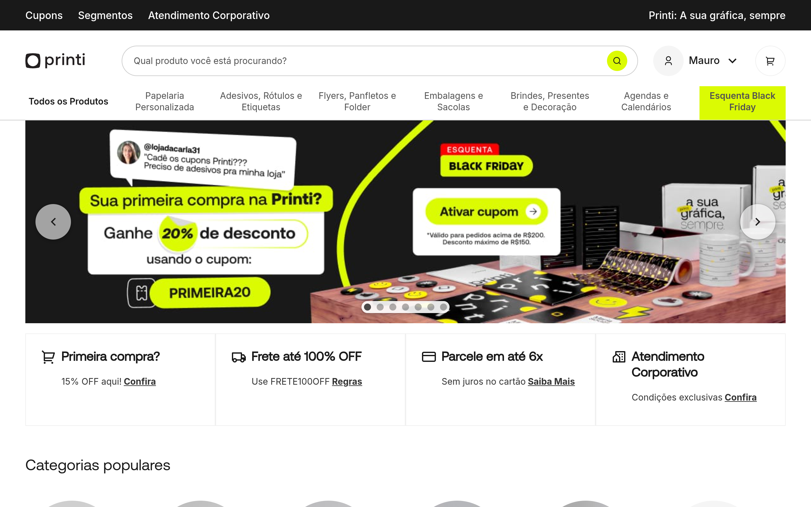

# printi DESIGN.md

> Auto-generated design system — reverse-engineered via static analysis by skillui.
> Frameworks: None detected
> Colors: 20 · Fonts: 2 · Components: 9
> Icon library: not detected · State: not detected
> Primary theme: light · Dark mode toggle: no · Motion: subtle

## Visual Reference

**Match this design exactly** — study colors, fonts, spacing, and component shapes before writing any UI code.



---

## 1. Visual Theme & Atmosphere

This is a **light-themed** interface with a warm, approachable feel. The light background emphasizes content clarity. Typography pairs **__Aeonik_13d87c** for display/headings with **__Aeonik_Fallback_13d87c** for body text, creating clear visual hierarchy through type contrast. Spacing follows a **4px base grid** (compact density), with scale: 2, 4, 6, 8, 10, 12, 16, 20px. The accent color **#b5ff95** anchors interactive elements (buttons, links, focus rings). Motion is subtle — smooth transitions (150-300ms) ease state changes without drawing attention.

---

## 2. Color Palette & Roles

| Token | Hex | Role | Use |
|---|---|---|---|
| theme-color | `#ffffff` | background | Page background, darkest surface |
| color-grey-50 | `#f5f5f5` | surface | Card and panel backgrounds |
| text-primary | `#000000` | text-primary | Headings and body text |
| color-grey-500 | `#525252` | text-muted | Captions, placeholders, secondary info |
| color-grey-800 | `#232323` | border | Dividers, card borders, outlines |
| color-green-100 | `#b5ff95` | accent | CTAs, links, focus rings, active states |
| color-green-0 | `#efffe8` | success | Success states, positive indicators |
| color-orange-50 | `#fff3d3` | warning | Warning states, caution indicators |
| color-blue-600 | `#009bff` | info | Informational highlights |
| color-grey-900 | `#191919` | unknown | Palette color |
| color-neon-green-400 | `#dbfb03` | unknown | Palette color |
| color-blue-700 | `#0875c5` | unknown | Palette color |
| color-grey-400 | `#8f8f8f` | unknown | Palette color |
| color-grey-200 | `#e0e0e0` | unknown | Palette color |
| color-grey-300 | `#cccccc` | unknown | Palette color |
| color-grey-600 | `#3d3d3d` | unknown | Palette color |
| color-grey-700 | `#333333` | unknown | Palette color |
| color-green-50 | `#d8ffc7` | unknown | Palette color |
| color-green-200 | `#86ff52` | unknown | Palette color |
| color-green-300 | `#4ced07` | unknown | Palette color |

### CSS Variable Tokens

```css
--elements-border-color: var(--color-grey-100);
--action-bg-primary-color: var(--color-grey-900);
--action-bg-secondary-color: var(--color-neon-green-400);
--action-border-primary-color: var(--color-grey-900);
--action-border-secondary-color: var(--color-neon-green-400);
--action-border-cta-color: var(--color-neon-green-400);
--action-label-primary-color: var(--color-grey-900);
--action-label-secondary-color: var(--color-neon-green-800);
--action-icon-primary-color: var(--color-grey-900);
--action-icon-secondary-color: var(--color-neon-green-800);
--on-action-label-primary-color: var(--color-grey-0);
--on-action-label-secondary-color: var(--color-neon-green-800);
--on-action-icon-primary-color: var(--color-grey-0);
--on-action-icon-secondary-color: var(--color-neon-green-800);
--inverse-border-color: var(--color-grey-0);
--active-border-color: var(--color-grey-900);
--unselected-border-color: var(--color-grey-200);
--selected-border-color: var(--color-grey-900);
--disabled-border-color: var(--color-grey-200);
--negative-border-color: var(--color-red-600);
```


---

## 3. Typography Rules

**Font Stack:**
- **__Aeonik_Fallback_13d87c** — Heading 1, Heading 2, Heading 3
- **__Aeonik_13d87c** — Body, Caption

**Font Sources:**

```css
@font-face {
  font-family: "__Aeonik_13d87c";
  src: url("fonts/__Aeonik_13d87c-Regular.woff2") format("woff2");
  font-weight: 400;
}
@font-face {
  font-family: "__Inter_d8ebd1";
  src: url("fonts/__Inter_d8ebd1-100.woff2") format("woff2");
  font-weight: 100;
}
```

| Role | Font | Size | Weight |
|---|---|---|---|
| Heading 1 | __Aeonik_Fallback_13d87c | 32px | 700 |
| Heading 2 | __Aeonik_Fallback_13d87c | var(--font-size-md,24px) | 700 |
| Heading 3 | __Aeonik_Fallback_13d87c | 1.5rem | 700 |
| Body | __Aeonik_13d87c | var(--font-size-2xs,14px) | 400 |
| Caption | __Aeonik_13d87c | var(--font-size-xs,16px) | 400 |

**Typographic Rules:**
- Limit to 2 font families max per screen
- Use **__Aeonik_Fallback_13d87c** for body/UI text, **__Aeonik_13d87c** for display/headings
- Maintain consistent hierarchy: no more than 3-4 font sizes per screen
- Headings use bold (600-700), body uses regular (400)
- Line height: 1.5 for body text, 1.2 for headings
- Use color and opacity for secondary hierarchy, not additional font sizes


---

## 4. Component Stylings

### Layout (1)

**Footer** — `html`

### Navigation (1)

**Navigation** — `html`

### Data Display (1)

**List** — `html`

### Data Input (2)

**Button** — `html`
- Animation: 

**Input** — `html`
- State: :focus, :placeholder

### Overlay (1)

**Modal** — `html`

### Media (3)

**Image** — `html`

**Icon** — `html`

**Map/Canvas** — `html`


---

## 5. Layout Principles

- **Base spacing unit:** 4px
- **Spacing scale:** 2, 4, 6, 8, 10, 12, 16, 20, 24, 40, 48, 80
- **Border radius:** 4px, 16px, 416.667px, 500px, inherit
- **Max content width:** 63.875em

**Spacing as Meaning:**
| Spacing | Use |
|---|---|
| 4-8px | Tight: related items within a group |
| 12-16px | Medium: between groups |
| 24-32px | Wide: between sections |
| 48px+ | Vast: major section breaks |


---

## 6. Depth & Elevation

### Flat — subtle depth hints

- `0px 1px 2px rgba(16,24,40,0.05)`

### Raised — cards, buttons, interactive elements

- `0 2px 8px rgba(0,0,0,0.25),0 0 0 1px rgba(0,0,0,0.08)`
- `var(--shadow-level-3)`
- `var(--shadow-md)`

### Z-Index Scale

`0, 1, 2, 1000, 1001, 1002, 2000, 3000, 9998, 9999`


---

## 7. Animation & Motion

This project uses **subtle motion**. Transitions smooth state changes without demanding attention.

### CSS Animations

- `@keyframes cmYSia`
- `@keyframes bVpqQb`
- `@keyframes lagRDW`
- `@keyframes clickBlink`

### Animated Components

- **Button**: 

### Motion Guidelines

- Duration: 150-300ms for micro-interactions, 300-500ms for page transitions
- Easing: `ease-out` for enters, `ease-in` for exits
- Always respect `prefers-reduced-motion`


---

## 8. Do's and Don'ts

### Do's

- Use `#b5ff95` for interactive elements (buttons, links, focus rings)
- Use `#ffffff` as the primary page background
- Pair **__Aeonik_Fallback_13d87c** (body) with **__Aeonik_13d87c** (display) — these are the only allowed fonts
- Follow the **4px** spacing grid for all margins, padding, and gaps
- Use the defined shadow tokens for elevation — see Section 6
- Use border-radius from the scale: 4px, 16px, 416.667px, 500px, inherit
- Reuse existing components from Section 4 before creating new ones

### Don'ts

- Don't introduce colors outside this palette — extend the design tokens first
- Don't introduce additional font families beyond __Aeonik_Fallback_13d87c and __Aeonik_13d87c
- Don't use arbitrary spacing values — stick to multiples of 4px
- Don't create custom box-shadow values outside the system tokens
- Don't use arbitrary border-radius values — pick from the defined scale
- Don't duplicate component patterns — check Section 4 first
- Don't use backdrop-blur or blur effects

### Anti-Patterns (detected from codebase)

- No blur or backdrop-blur effects
- No zebra striping on tables/lists


---

## 9. Responsive Behavior

| Name | Value | Source |
|---|---|---|
| xs | 25em | css |
| md | 48em | css |
| lg | 63.875em | css |
| lg | 63.9375em | css |
| xs | 320px | css |
| xs | 321px | css |
| xs | 345px | css |
| xs | 360px | css |
| xs | 438px | css |
| xs | 458px | css |
| sm | 600px | css |
| sm | 614px | css |
| md | 735px | css |
| md | 736px | css |
| md | 767px | css |
| md | 768px | css |
| lg | 769px | css |
| lg | 991px | css |
| lg | 992px | css |
| lg | 1021px | css |
| lg | 1023px | css |
| lg | 1024px | css |
| xl | 1025px | css |
| xl | 1044px | css |
| xl | 1138px | css |
| 2xl | 1400px | css |
| 2xl | 1439px | css |
| 2xl | 1440px | css |
| 2xl | 1480px | css |

**Approach:** Use `@media (min-width: ...)` queries matching the breakpoints above.


---

## 10. Agent Prompt Guide

Use these as starting points when building new UI:

### Build a Card

```
Background: #f5f5f5
Border: 1px solid #232323
Radius: 416.667px
Padding: 16px
Font: __Aeonik_Fallback_13d87c
Use shadow tokens from Section 6.
```

### Build a Button

```
Primary: bg #b5ff95, text white
Ghost: bg transparent, border #232323
Padding: 8px 16px
Radius: 416.667px
Hover: opacity 0.9 or lighter shade
Focus: ring with #b5ff95
```

### Build a Page Layout

```
Background: #ffffff
Max-width: 63.875em, centered
Grid: 4px base
Responsive: mobile-first, breakpoints from Section 9
```

### Build a Stats Card

```
Surface: #f5f5f5
Label: #525252 (muted, 12px, uppercase)
Value: #000000 (primary, 24-32px, bold)
Status: use success/warning/danger from Section 2
```

### Build a Form

```
Input bg: #ffffff
Input border: 1px solid #232323
Focus: border-color #b5ff95
Label: #525252 12px
Spacing: 16px between fields
Radius: 416.667px
```

### General Component

```
1. Read DESIGN.md Sections 2-6 for tokens
2. Colors: only from palette
3. Font: __Aeonik_Fallback_13d87c, type scale from Section 3
4. Spacing: 4px grid
5. Components: match patterns from Section 4
6. Elevation: shadow tokens
```
